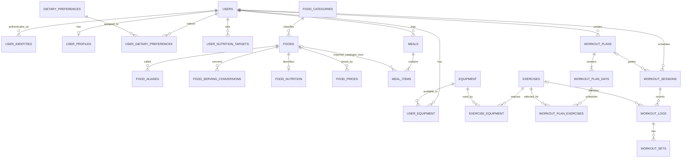

# FitAI database design

This milestone adds an Azure SQL compatible relational schema. It is intentionally limited to schema and reference lookup data: the migration does not create a cloud database, connect to Azure, insert user data, or seed made-up food nutrition or prices.

## Apply locally or to a configured database

1. Connect a SQL client to the intended Azure SQL Database (or a SQL Server development database) and select that database.
2. Execute [`db/migrations/001_initial_schema.sql`](../db/migrations/001_initial_schema.sql) as one batch. It is additive, runs in a transaction, and records `001_initial_schema` in `dbo.SchemaMigrations`. Rerunning it reports that the migration is already applied.
3. Execute [`db/seeds/001_reference_data.sql`](../db/seeds/001_reference_data.sql) after the migration. It adds category, dietary preference, and equipment lookups without overwriting or deleting existing rows. It can be rerun.
4. Execute [`db/migrations/002_role_auth_and_assignments.sql`](../db/migrations/002_role_auth_and_assignments.sql) for role-based accounts and assignment management. It adds a nullable bcrypt hash to `UserIdentities`, a one-role-per-account `UserRoles` table, trainer applications, requests, assignment history, and admin audit events. It is additive and does not remove existing rows.
5. Confirm the result with:

```sql
SELECT MigrationId, AppliedAtUtc
FROM dbo.SchemaMigrations;

SELECT CategoryCode, CategoryName
FROM dbo.FoodCategories
ORDER BY CategoryName;

SELECT MigrationId, AppliedAtUtc
FROM dbo.SchemaMigrations
WHERE MigrationId = N'002_role_auth_and_assignments';
```

These scripts have **not** been run against Azure SQL because no database resource or credentials are configured in this workspace. The migration uses Azure SQL / SQL Server T-SQL, `TRY...CATCH`, `THROW`, and `SET XACT_ABORT ON`; Microsoft documents how `XACT_ABORT` rolls back a failed transaction [here](https://learn.microsoft.com/en-us/sql/t-sql/statements/set-xact-abort-transact-sql?view=sql-server-ver16).

## Entity relationship diagram

The source diagram is [`docs/diagrams/fitai-er.mmd`](diagrams/fitai-er.mmd).



## Tables and relationships

| Area | Tables | Purpose |
| --- | --- | --- |
| Identity and profile | `Users`, `UserIdentities`, `UserRoles`, `UserProfiles`, `TrainerProfiles`, `DietaryPreferences`, `UserDietaryPreferences`, `UserNutritionTargets` | Keep the application user key separate from authentication-provider subjects; password identities store bcrypt hashes only. Roles are server-assigned in `UserRoles`; profiles and dated nutrition targets are separate. |
| Trainer workflow | `TrainerRequests`, `TrainerAssignments`, `AdminAuditEvents` | Preserve member requests and assignment history, allow one active trainer per member, and record administrative approval and assignment actions. |
| Food reference | `FoodCategories`, `Foods`, `FoodAliases`, `FoodServingConversions`, `FoodNutrition`, `FoodPrices` | Keep food names, alternate names, portion conversions, nutrient facts, and price observations separate. Nutrition, conversions, and prices carry source and evidence status. Unknown nutrient fields remain `NULL`. |
| Meal tracking | `Meals`, `MealItems` | A user owns a dated meal; each item captures the confirmed name, portion, and nutrition values used at logging time. An item can refer to the catalogue or remain unmatched (`FoodId` is nullable). |
| Exercise reference | `Exercises`, `Equipment`, `ExerciseEquipment`, `UserEquipment` | Model exercises and equipment as reusable reference data, with many-to-many junction tables for exercise requirements and user availability. |
| Workout planning and history | `WorkoutPlans`, `WorkoutPlanDays`, `WorkoutPlanExercises`, `WorkoutSessions`, `WorkoutLogs`, `WorkoutSets` | Separate a reusable plan from dated sessions, exercise logs, and individual performed sets. A log keeps the exercise name snapshot if its reference later becomes inactive. |
| Migration tracking | `SchemaMigrations` | Record successful migration identifiers and UTC application time. |

## Normalization and integrity choices

- **One fact per relation:** profiles are separate from authentication identity, food nutrition is separate from prices, and workout plans are separate from performed sessions. A food can have many price observations without repeating its food name or nutrient record.
- **Many-to-many relations use junction tables:** dietary preferences, available equipment, and exercise-equipment requirements each have composite primary keys to prevent duplicate assignments.
- **Targets retain their effective date:** the unique `(UserId, EffectiveFrom)` key lets a user change a target without rewriting older target periods.
- **Nutrients and prices include provenance:** `EvidenceStatus` distinguishes `Verified` and `Estimated`; source name, observed/verified date, reference amount, and unit give application code enough context to explain the value. Nullable nutrition fields mean “unknown,” not zero.
- **Aliases and portion conversions are explicit reference data:** natural-language matching can search food aliases, and a serving such as a bowl can map to a measured amount only when the conversion has provenance. Before calculating nutrition, application code must ensure the conversion unit matches the nutrient reference unit or apply a validated unit conversion.
- **Historical logs retain snapshots:** a catalogue correction must not silently change a meal the user previously confirmed. The saved portion, nutrition values, evidence status, and nutrition source snapshot represent what was used at logging time. Unmatched items remain visible without inventing a catalogue match.
- **Constraints protect data at the database boundary:** primary/unique keys prevent duplicate identities and assignments; foreign keys protect relationships; check constraints restrict goals, meal types, workout splits, portions, weights, and evidence statuses.
- **Deletes are explicit:** the migration does not use broad cascading deletes. Account-erasure and parent/child deletion must be implemented as deliberate server-side transactions so the behavior is auditable and cannot silently erase unrelated records.

## Ownership and security boundary

Every user-owned table includes `UserId`, and child records use composite foreign keys such as `(MealId, UserId)` to ensure the referenced parent belongs to the same user. These constraints stop inconsistent cross-user relationships from being stored. They do not replace authorization: private reads and writes must still derive `UserId` from the authenticated server session and include it in every query predicate. The browser must never select an arbitrary owner ID. Row-level security and the authenticated database connection/session policy are part of the upcoming connection and security milestones; they are not claimed as implemented by this schema milestone.

## Index choices

- `IX_Meals_User_Date (UserId, MealDate DESC, MealId DESC)` supports one user’s date-bounded meal history and stable pagination.
- `IX_MealItems_Meal_User` supports loading a meal’s items and covering common nutrition totals.
- Filtered `IX_Foods_SearchName_Active` supports catalogue search while avoiding inactive rows; the category index supports category filters.
- `IX_FoodPrices_Food_ObservedOn` supports selecting the most recent applicable price observation for a food.
- `IX_WorkoutSessions_User_Date` supports a user’s workout history by date and status.
- Plan/day/set indexes follow the parent key and display order used when rendering a saved plan or workout.

Indexes add storage and write cost. These are based on the product’s current read patterns; they should be revisited with real query plans and representative data before tuning a deployed workload.

The active-food indexes use SQL Server filtered-index syntax for a subset of rows. Azure SQL Database supports filtered indexes; see Microsoft’s [filtered-index documentation](https://learn.microsoft.com/en-us/sql/relational-databases/indexes/create-filtered-indexes?view=sql-server-ver17).

## Example SQL operations

In application code these variables are bound parameters. `@UserId` must come from authenticated server state, never from a browser field. Dates are inclusive at the beginning and exclusive at the end so a caller can request a local day range without timestamp boundary errors.

### Search active catalogue foods

```sql
SELECT TOP (25) f.FoodId, f.FoodName, c.CategoryName,
       alias.Match AS MatchedAlias,
       n.ReferenceAmount, n.ReferenceUnit,
       n.CaloriesKcal, n.ProteinGrams, n.EvidenceStatus, n.SourceName
FROM dbo.Foods AS f
JOIN dbo.FoodCategories AS c ON c.FoodCategoryId = f.FoodCategoryId
LEFT JOIN dbo.FoodNutrition AS n ON n.FoodId = f.FoodId
OUTER APPLY
(
    SELECT TOP (1) a.Alias AS Match
    FROM dbo.FoodAliases AS a
    WHERE a.FoodId = f.FoodId
      AND a.LanguageCode = @LanguageCode
      AND a.SearchName LIKE @SearchPrefix + N'%'
    ORDER BY a.SearchName
) AS alias
WHERE f.IsActive = 1
  AND (f.SearchName LIKE @SearchPrefix + N'%' OR alias.Match IS NOT NULL)
ORDER BY f.SearchName, f.FoodId;
```

### Read one user’s meal history and confirmed items

```sql
SELECT m.MealId, m.MealDate, m.MealType, m.Notes,
       i.MealItemId, i.FoodNameSnapshot, i.ServingAmount, i.ServingUnit,
       i.CaloriesKcal, i.ProteinGrams, i.EvidenceStatus,
       i.NutritionSourceSnapshot, i.NutritionSourceUrlSnapshot
FROM dbo.Meals AS m
LEFT JOIN dbo.MealItems AS i
  ON i.MealId = m.MealId AND i.UserId = m.UserId
WHERE m.UserId = @UserId
  AND m.MealDate >= @StartDate
  AND m.MealDate < @EndDate
ORDER BY m.MealDate DESC, m.MealId DESC, i.MealItemId;
```

### Create a meal and its confirmed items atomically

The application inserts the parent and child rows in one parameterized transaction. Any invalid item rolls the whole write back. This abbreviated example shows the parent key handoff; the real service will validate all portions and compute snapshots from validated catalogue quantities before insert.

```sql
SET XACT_ABORT ON;
BEGIN TRY
    BEGIN TRANSACTION;
    DECLARE @CreatedMeal TABLE (MealId bigint NOT NULL);

    INSERT dbo.Meals (UserId, MealDate, MealType, Notes)
    OUTPUT inserted.MealId INTO @CreatedMeal (MealId)
    VALUES (@UserId, @MealDate, @MealType, @Notes);

    DECLARE @MealId bigint = (SELECT MealId FROM @CreatedMeal);
    INSERT dbo.MealItems
        (MealId, UserId, FoodId, FoodNameSnapshot, ServingAmount, ServingUnit,
         CaloriesKcal, ProteinGrams, CarbohydrateGrams, FatGrams,
         NutritionSourceSnapshot, NutritionSourceUrlSnapshot, EvidenceStatus)
    SELECT @MealId, @UserId, item.FoodId, item.FoodName, item.ServingAmount, item.ServingUnit,
           item.CaloriesKcal, item.ProteinGrams, item.CarbohydrateGrams,
           item.FatGrams, item.SourceName, item.SourceUrl, item.EvidenceStatus
    FROM @ConfirmedItems AS item;

    COMMIT TRANSACTION;
END TRY
BEGIN CATCH
    IF XACT_STATE() <> 0 ROLLBACK TRANSACTION;
    THROW;
END CATCH;
```

`@ConfirmedItems` above represents a table-valued input in illustrative SQL; the application implementation will use parameterized driver requests and a transaction, not concatenate user-provided SQL.

### Daily nutrition report with an explicit incomplete-data count

```sql
SELECT m.MealDate,
       SUM(i.CaloriesKcal) AS KnownCaloriesKcal,
       SUM(i.ProteinGrams) AS KnownProteinGrams,
       SUM(CASE WHEN i.MealItemId IS NOT NULL AND i.CaloriesKcal IS NULL THEN 1 ELSE 0 END) AS ItemsMissingCalories
FROM dbo.Meals AS m
LEFT JOIN dbo.MealItems AS i
  ON i.MealId = m.MealId AND i.UserId = m.UserId
WHERE m.UserId = @UserId
  AND m.MealDate >= @StartDate
  AND m.MealDate < @EndDate
GROUP BY m.MealDate
ORDER BY m.MealDate;
```

`SUM` ignores unknown values; the missing count keeps a partial total from being presented as complete. A day with no known calories is not the same as a day with zero calories.

### Rank foods by protein per rupee only when units match

```sql
SELECT f.FoodId, f.FoodName,
       n.ProteinGrams * p.QuantityAmount
         / NULLIF(n.ReferenceAmount * p.PriceAmount, 0) AS ProteinGramsPerRupee,
       p.ObservedOn, p.SourceName
FROM dbo.Foods AS f
JOIN dbo.FoodNutrition AS n ON n.FoodId = f.FoodId
CROSS APPLY
(
    SELECT TOP (1) fp.*
    FROM dbo.FoodPrices AS fp
    WHERE fp.FoodId = f.FoodId
      AND fp.EvidenceStatus = 'Verified'
      AND fp.CurrencyCode = 'INR'
      AND fp.QuantityUnit = n.ReferenceUnit
      AND fp.ObservedOn <= @AsOfDate
      AND (fp.ExpiresOn IS NULL OR fp.ExpiresOn >= @AsOfDate)
    ORDER BY fp.ObservedOn DESC, fp.FoodPriceId DESC
) AS p
WHERE f.IsActive = 1
  AND n.ProteinGrams IS NOT NULL
ORDER BY ProteinGramsPerRupee DESC;
```

This query deliberately excludes missing, estimated, expired, or unit-incomparable prices. Unit conversions and user-specific affordability rules belong in validated business logic.

### Workout completion counts

```sql
SELECT s.SessionStatus, COUNT_BIG(*) AS SessionCount
FROM dbo.WorkoutSessions AS s
WHERE s.UserId = @UserId
  AND s.SessionDate >= @StartDate
  AND s.SessionDate < @EndDate
GROUP BY s.SessionStatus;
```

## Transactional and analytical work

Meal edits, deletes, plan updates, and session logging are transactional operations and should run in short transactions with ownership predicates. Dashboard and progress totals are bounded reporting queries over those operational tables. At this project scale, Azure SQL can serve both. If reporting becomes expensive, evaluate indexed views or a separate analytical store only after measuring workload; this project does not add a warehouse or Power BI dependency now.
